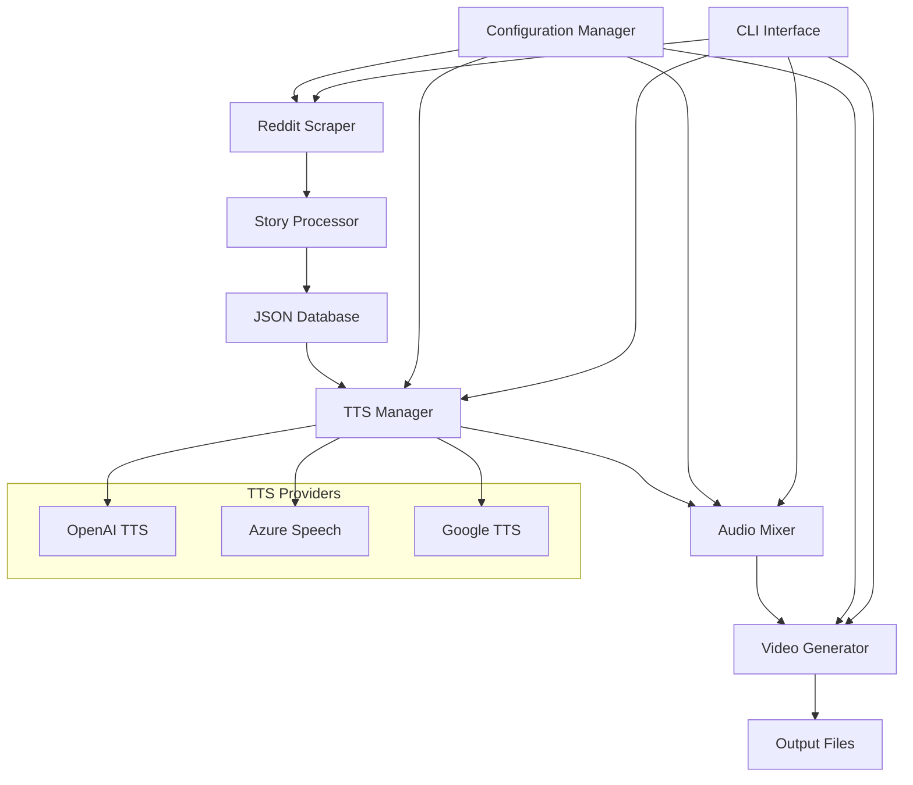

<div align="center">

# 🎭 CreepyPasta AI - Vibe Coding Project 👻

**AI-Powered Horror Story Narration with Atmospheric Multimedia Experiences**

[](https://www.python.org/downloads/)
[](https://opensource.org/licenses/MIT)
[](https://github.com/psf/black)
[](CONTRIBUTING.md)

[🚀 Quick Start](#-quick-start) • [📖 Documentation](#-table-of-contents) • [🔧 Installation](#-installation) • [💡 Examples](#-usage-examples) • [🤝 Contributing](#-contributing)

</div>

---

## 📋 Table of Contents

- [🎯 Target Audience](#-target-audience)
- [✨ Key Features](#-key-features)
- [🏗️ Architecture](#%EF%B8%8F-architecture)
- [🔧 Installation](#-installation)
- [⚙️ Configuration](#%EF%B8%8F-configuration)
- [🚀 Quick Start](#-quick-start)
- [💡 Usage Examples](#-usage-examples)
- [🔄 Execution Modes](#-execution-modes)
- [📊 Project Structure](#-project-structure)
- [🎵 Audio & Video Features](#-audio--video-features)
- [🛠️ API Documentation](#%EF%B8%8F-api-documentation)
- [🔍 Troubleshooting](#-troubleshooting)
- [❓ FAQ](#-faq)
- [🤝 Contributing](#-contributing)
- [📄 License](#-license)
- [📞 Support & Contact](#-support--contact)

---

## 🔍 SEO Keywords

`creepypasta`, `AI narration`, `text-to-speech`, `horror stories`, `Reddit scraper`, `audio generation`, `video creation`, `atmospheric audio`, `Python automation`, `multimedia content`, `TTS voices`, `OpenAI`, `Azure Speech`, `content creation`, `horror content generator`

---

## 🎯 Target Audience

**CreepyPasta AI** is designed for:
- 🎬 **Content Creators** who want automated horror story narration
- 📱 **Social Media Managers** creating engaging horror content
- 🎙️ **Podcasters** looking for atmospheric audio experiences
- 👨‍💻 **Developers** interested in AI-powered content generation
- 🎨 **Horror Enthusiasts** who enjoy immersive storytelling experiences

---

## ✨ Key Features

### 🤖 AI-Powered Content Generation
- **Multi-Provider TTS**: OpenAI, Azure Speech Services, Google TTS with intelligent fallback
- **Natural Voice Selection**: Multiple voice options including horror-optimized tones
- **Smart Text Processing**: Automatic text cleaning and optimization for speech synthesis
- **AI-Generated Imagery**: Create atmospheric horror visuals for video content

### 🌍 Multilingual Support
- **13+ Supported Languages**: Generate content in English, Dutch, German, French, Spanish, and more
- **Automatic Translation**: Convert Reddit stories to your preferred language using multiple providers
- **Language-Specific Voices**: Native-sounding TTS voices optimized for each language
- **Dynamic Language Management**: Enable/disable languages runtime with simple CLI commands
- **Batch Multilingual Processing**: Generate content in multiple languages simultaneously

### 📊 Data Management & Intelligence
- **Reddit Integration**: Automated scraping from r/creepypasta with intelligent filtering
- **Smart Duplicate Detection**: Advanced algorithms prevent content repetition
- **JSON Database**: Comprehensive story tracking with metadata and analytics
- **Content Quality Scoring**: Automatic story quality assessment and filtering

### 🎵 Professional Audio Production
- **Atmospheric Audio Mixing**: Background music, sound effects, and ambient noise
- **Professional Audio Effects**: Echo, reverb, and horror-specific audio enhancements
- **Multi-Format Export**: MP3, WAV, and other popular audio formats
- **Volume Normalization**: Consistent audio levels across all generated content

### 🎬 Video Generation & Multimedia
- **Automated Video Creation**: Sync narration with AI-generated horror imagery
- **Visual Effects**: Atmospheric lighting, transitions, and horror-themed effects
- **Multiple Output Formats**: MP4, AVI support with customizable quality settings
- **Thumbnail Generation**: Automatic creation of engaging video thumbnails

### ⚡ Performance & Scalability
- **Batch Processing**: Generate multiple stories simultaneously
- **Resource Optimization**: Efficient memory and CPU usage management
- **Cross-Platform**: Full Windows, macOS, and Linux compatibility
- **Modular Architecture**: Run individual components independently

---

## 🏗️ Architecture



---

## 🔧 Installation

### Prerequisites

> **⚠️ Important**: Ensure you have **FFmpeg** installed for audio/video processing
> - **Windows**: Download from [ffmpeg.org](https://ffmpeg.org/download.html) and add to PATH
> - **macOS**: `brew install ffmpeg`
> - **Linux**: `sudo apt install ffmpeg` (Ubuntu/Debian) or equivalent

- **Python 3.8 or higher** (Python 3.13 recommended)
- **Git** for cloning the repository
- **Reddit API credentials** (free registration required)
- **Optional**: OpenAI or Azure API keys for premium TTS voices

### Step-by-Step Installation

1. **Clone the Repository**
   ```bash
   git clone https://github.com/DubblePumper/creepypasta-ai.git
   cd creepypasta-ai
   ```

2. **Create Virtual Environment** (Recommended)
   ```bash
   python -m venv creepypasta_env
   
   # Activate virtual environment
   # Windows:
   creepypasta_env\Scripts\activate
   
   # macOS/Linux:
   source creepypasta_env/bin/activate
   ```

3. **Install Dependencies**
   ```bash
   pip install -r requirements.txt
   ```

4. **Set Up Environment Variables**
   ```bash
   # Copy the example environment file
   cp .env.example .env  # Windows: copy .env.example .env
   ```

5. **Configure API Credentials** (Edit `.env` file)
   ```env
   # Reddit API (Required - Get from https://www.reddit.com/prefs/apps)
   REDDIT_CLIENT_ID=your_client_id_here
   REDDIT_CLIENT_SECRET=your_client_secret_here
   REDDIT_USER_AGENT=CreepyPastaAI/1.0
   
   # OpenAI API (Optional - Premium TTS)
   OPENAI_API_KEY=your_openai_api_key_here
   
   # Azure Speech (Optional - Premium TTS)
   AZURE_SPEECH_KEY=your_azure_key_here
   AZURE_SPEECH_REGION=your_region_here
   ```

6. **Verify Installation**
   ```bash
   python main.py --info
   ```

### 🌍 Multilingual Quick Start

CreepyPasta AI supports 13+ languages with automatic translation and language-specific voices:

1. **Check Available Languages**
   ```bash
   python main.py --list-languages
   ```

2. **Enable Additional Languages**
   ```bash
   # Enable Dutch and German
   python main.py --enable-language nl
   python main.py --enable-language de
   
   # Check current status
   python main.py --language-status
   ```

3. **Generate Content in Different Languages**
   ```bash
   # Generate stories in Dutch with translation
   python main.py --mode complete --language nl --translate --stories 3
   
   # Generate audio in German
   python main.py --mode audio --language de --translate
   ```

4. **Batch Process Multiple Languages**
   ```bash
   # Process multiple languages at once
   python main.py --languages "nl,de,fr" --translate --stories 2
   ```

For detailed multilingual configuration and advanced features, see the [Multilingual Guide](docs/multilingual-guide.md).

---

## ⚙️ Configuration

### Environment Variables (`.env`)

| Variable | Required | Description | Example |
|----------|----------|-------------|---------|
| `REDDIT_CLIENT_ID` | ✅ | Reddit API client ID | `abc123def456` |
| `REDDIT_CLIENT_SECRET` | ✅ | Reddit API client secret | `secret_key_here` |
| `REDDIT_USER_AGENT` | ✅ | User agent for Reddit API | `CreepyPastaAI/1.0` |
| `OPENAI_API_KEY` | ❌ | OpenAI API key for premium TTS | `sk-proj-...` |
| `AZURE_SPEECH_KEY` | ❌ | Azure Speech Services key | `azure_key_here` |
| `AZURE_SPEECH_REGION` | ❌ | Azure region | `eastus` |
| `NUM_STORIES` | ❌ | Default number of stories to process | `10` |
| `DEBUG` | ❌ | Enable debug logging | `false` |

### Application Settings (`config/settings.yaml`)

```yaml
reddit:
  subreddit: "creepypasta"
  limit: 10
  min_score: 5              # Minimum upvotes required
  min_length: 500           # Minimum character count
  max_length: 10000         # Maximum character count

tts:
  provider: "openai"        # Options: gtts, openai, azure
  language: "en"
  
  openai:
    model: "tts-1"          # Options: tts-1, tts-1-hd
    voice: "onyx"           # Options: alloy, echo, fable, onyx, nova, shimmer
    speed: 1.0              # Speech speed (0.25 to 4.0)
  
  azure:
    voice: "en-US-AriaNeural"
    rate: "+0%"             # Speech rate adjustment
    pitch: "+0Hz"           # Pitch adjustment

audio:
  background_music: true
  music_volume: 0.3         # Background music volume (0.0 to 1.0)
  voice_volume: 0.8         # Narration volume (0.0 to 1.0)
  effects: true             # Enable audio effects
  sample_rate: 44100        # Audio sample rate
  format: "mp3"             # Output format

video:
  enabled: true
  resolution: "1920x1080"   # Video resolution
  fps: 30                   # Frames per second
  background_images: true   # Use AI-generated backgrounds
  
  # Subtitle configuration
  subtitles:
    enabled: false          # Enable/disable subtitle generation
    font_size: 24           # Font size in pixels
    font_color: "white"     # Text color (white, yellow, etc.)
    outline_color: "black"  # Outline color for readability
    outline_width: 2        # Outline thickness in pixels
    position: "bottom"      # Position: bottom, top, center
    max_chars_per_line: 50  # Maximum characters per line
    words_per_subtitle: 8   # Words per subtitle segment

output:
  directory: "assets/output"
  audio_format: "mp3"
  video_format: "mp4"
  organize_by_date: true    # Create date-based folders
```

### 📝 Subtitle Configuration Details

The subtitle system provides professional-quality subtitle generation and overlay for your CreepyPasta videos. Here's a detailed breakdown of all available subtitle options:

#### Basic Subtitle Settings

```yaml
video:
  subtitles:
    enabled: true           # Master switch for subtitle functionality
```

#### Text Formatting Options

```yaml
video:
  subtitles:
    font_size: 24          # Font size in pixels (recommended: 20-32)
    font_color: "white"    # Options: white, yellow, cyan, red, green
    outline_color: "black" # Outline color for text readability
    outline_width: 2       # Outline thickness (recommended: 1-3)
```

#### Positioning and Layout

```yaml
video:
  subtitles:
    position: "bottom"           # Options: bottom, top, center
    max_chars_per_line: 50       # Maximum characters per subtitle line
    words_per_subtitle: 8        # Words per subtitle segment
```

#### Advanced Subtitle Configuration

For fine-tuned control, you can customize additional subtitle properties:

```yaml
video:
  subtitles:
    enabled: true
    font_size: 28
    font_color: "white"
    outline_color: "black"
    outline_width: 2
    position: "bottom"
    max_chars_per_line: 45       # Shorter lines for better readability
    words_per_subtitle: 6        # Fewer words for dramatic pacing
    # Additional styling (applied via FFmpeg)
    alignment: 2                 # Subtitle alignment (1=left, 2=center, 3=right)
    margin_v: 50                 # Vertical margin from edge (pixels)
    shadow: true                 # Enable text shadow for better contrast
```

#### Subtitle Timing Examples

The subtitle system automatically calculates timing based on audio duration and text length. Here's how different settings affect subtitle pacing:

| Words per Subtitle | Reading Speed | Use Case |
|-------------------|---------------|----------|
| 4-6 words | Slow, dramatic | Horror emphasis, suspense |
| 6-8 words | Normal reading | Standard narration |
| 8-12 words | Fast pacing | Action sequences, dialogue |

#### Font Color Options

| Color | Hex Code | Best For |
|-------|----------|----------|
| `white` | #FFFFFF | General use, dark backgrounds |
| `yellow` | #FFFF00 | Classic subtitle style |
| `cyan` | #00FFFF | Modern, tech feel |
| `red` | #FF0000 | Horror emphasis |
| `green` | #00FF00 | Supernatural themes |

#### Troubleshooting Subtitle Issues

**Problem**: Subtitles not appearing
- ✅ Check `video.subtitles.enabled: true` in settings.yaml
- ✅ Ensure story content is available for subtitle generation
- ✅ Verify FFmpeg is properly installed

**Problem**: Subtitle timing is off
- ✅ Adjust `words_per_subtitle` value (lower = slower pacing)
- ✅ Check audio file duration matches expectations

**Problem**: Text is hard to read
- ✅ Increase `outline_width` to 3 or higher
- ✅ Use high contrast colors (white text, black outline)
- ✅ Increase `font_size` for better visibility

---

## 🚀 Quick Start

### Basic Usage

```bash
# Generate 5 complete stories (scrape → audio → video)
python main.py --mode complete --stories 5

# Quick test with 1 story
python main.py --stories 1
```

### Getting Reddit API Credentials

1. Go to https://www.reddit.com/prefs/apps
2. Click "Create App" or "Create Another App"
3. Choose "script" as the application type
4. Fill in the required information:
   - **Name**: `CreepyPasta AI`
   - **Description**: `AI-powered creepypasta narration`
   - **About URL**: (optional)
   - **Redirect URI**: `http://localhost:8080`
5. Copy the **client ID** (under the app name) and **client secret**
6. Add these to your `.env` file

---

## 💡 Usage Examples

### Example 1: Complete Workflow
```bash
# Generate 3 stories with full processing
python main.py --mode complete --stories 3

# Use specific TTS provider
python main.py --mode complete --stories 5 --tts openai
```

### Example 2: Individual Components
```bash
# Only scrape stories (no audio/video generation)
python main.py --mode scrape --stories 10

# Generate audio for existing stories
python main.py --mode audio

# Create videos for existing audio files
python main.py --mode video
```

### Example 3: Using Convenience Scripts

**Windows:**
```cmd
# Run complete workflow for 5 stories
scripts\complete.bat 5

# Scrape 20 stories only
scripts\scrape.bat 20

# Generate audio only
scripts\audio.bat

# Check system status
scripts\status.bat
```

**Linux/macOS:**
```bash
# Run complete workflow for 5 stories
./scripts/complete.sh 5

# Scrape 20 stories only
./scripts/scrape.sh 20

# Generate audio only
./scripts/audio.sh

# Check system status
./scripts/status.sh
```

### Example 4: Advanced Configuration
```bash
# Use custom configuration file
python main.py --config custom_settings.yaml

# Enable debug mode
python main.py --debug --stories 1

# Specify output directory
python main.py --output /path/to/output --stories 3
```

### Example 5: Subtitle-Enabled Video Generation

Generate videos with professional subtitles enabled:

```bash
# Enable subtitles in your configuration first
# Edit config/settings.yaml:
# video:
#   subtitles:
#     enabled: true
#     font_size: 24
#     font_color: "white"

# Generate videos with subtitles
python main.py --mode complete --stories 3

# Create videos only with subtitle overlay
python main.py --mode video
```

**Custom Subtitle Styling:**
```yaml
# config/settings.yaml
video:
  subtitles:
    enabled: true
    font_size: 28
    font_color: "yellow"     # Classic subtitle appearance
    outline_color: "black"
    outline_width: 3         # Thick outline for better readability
    position: "bottom"
    max_chars_per_line: 45   # Shorter lines for mobile viewing
    words_per_subtitle: 6    # Slower pacing for horror emphasis
```

### Example 6: Batch Processing with Subtitles

Process multiple stories with different subtitle configurations:

```bash
# Process 10 stories with subtitles enabled
python main.py --mode complete --stories 10

# Check generated subtitle files
ls temp/subtitles/

# Check final videos with embedded subtitles
ls assets/videos/
```

---

## 🔄 Execution Modes

CreepyPasta AI supports flexible execution modes for different use cases:

| Mode | Description | Command | Use Case |
|------|-------------|---------|----------|
| **Complete** | Full pipeline: scrape → audio → video | `--mode complete` | Production use, full automation |
| **Scrape** | Story collection only | `--mode scrape` | Data gathering, content research |
| **Audio** | Audio generation only | `--mode audio` | Audio content creation |
| **Video** | Video generation only | `--mode video` | Video content creation |
| **Info** | System information | `--info` | Troubleshooting, configuration check |
| **Stats** | Database statistics | `--stats` | Analytics, progress tracking |

### Benefits of Modular Execution
- 🔧 **Development & Testing**: Test individual components
- 🔄 **Error Recovery**: Resume from specific steps if failures occur
- 💾 **Resource Management**: Run resource-intensive operations separately
- 📊 **Batch Processing**: Process large numbers of stories in stages
- 🎯 **Selective Processing**: Generate content for specific steps only

---

## 📊 Project Structure

```
creepypasta-ai/
├── 📁 src/                     # Source code modules
│   ├── 🎵 audio/               # Audio processing components
│   │   ├── tts_manager.py      # Text-to-speech management
│   │   └── audio_mixer.py      # Audio mixing and effects
│   ├── 💻 cli/                 # Command-line interface
│   │   ├── cli_handler.py      # Argument parsing and validation
│   │   └── execution_modes.py  # Mode-specific execution handlers
│   ├── 🌐 scrapers/            # Data collection modules
│   │   └── reddit_scraper.py   # Reddit API integration
│   ├── 🔧 utils/               # Utility modules
│   │   ├── config_manager.py   # Configuration handling
│   │   ├── story_processor.py  # Text processing and validation
│   │   ├── story_tracker.py    # JSON database management
│   │   └── logger.py           # Logging utilities
│   └── 🎬 video/               # Video generation components
│       └── video_generator.py  # Video creation and effects
├── ⚙️ config/                  # Configuration files
│   └── settings.yaml           # Main application configuration
├── 💾 data/                    # Persistent data storage
│   └── generated_stories.json  # Story database with metadata
├── 🎨 assets/                  # Static assets and generated content
│   ├── images/                 # AI-generated horror imagery
│   ├── music/                  # Background music and sound effects
│   ├── output/                 # Generated audio files
│   └── videos/                 # Generated video content
├── 🧪 tests/                   # Test modules and validation
├── 📜 scripts/                 # Convenience execution scripts
├── 📚 docs/                    # Project documentation
├── 📝 logs/                    # Application logs
└── 🚀 main.py                  # Application entry point
```

### 🎯 Project Organization & Best Practices

This project follows structured development principles with clear separation of concerns and maintainable code architecture:

#### **📁 Code Organization**
- **Modular Design**: Each module has a single responsibility (TTS, scraping, video generation)
- **Clear File Naming**: Descriptive names for functions, classes, and variables
- **Logical Folder Structure**: Related functionality grouped together in dedicated folders
- **Separation of Concerns**: Configuration, processing, storage, and utilities are isolated

#### **🔧 Development Standards**
- **Clean Code**: Readable, maintainable code with comprehensive documentation
- **Error Handling**: Robust exception handling with graceful degradation
- **Type Hints**: Full type annotations for better code clarity and IDE support
- **Comprehensive Logging**: Detailed logging for debugging and monitoring
- **Configuration Management**: Centralized YAML-based configuration system

#### **📝 Documentation & Comments**
- **Docstrings**: All classes and methods include comprehensive documentation
- **Inline Comments**: Complex logic explained with clear comments
- **README Files**: Each major module includes dedicated documentation
- **API Documentation**: Clear examples and usage patterns provided

#### **🔄 Version Control & Collaboration**
- **Atomic Commits**: Frequent commits with clear, descriptive messages
- **Feature Branches**: Separate branches for new features and bug fixes
- **Code Reviews**: All changes reviewed for quality and adherence to standards
- **Issue Tracking**: Comprehensive tracking of bugs, features, and improvements

#### **🚀 Deployment & Distribution**
- **Dependency Management**: Well-documented dependencies with version pinning
- **Environment Configuration**: Support for development, testing, and production environments
- **Cross-Platform Support**: Compatible with Windows, macOS, and Linux
- **Easy Setup**: Simple installation with clear setup instructions

#### **🔐 Security & Data Protection**
- **Environment Variables**: Sensitive data stored securely in environment variables
- **API Key Management**: Secure handling of third-party service credentials
- **Data Validation**: Input validation and sanitization throughout the application
- **Privacy Compliance**: Respectful handling of user data and content

#### **⚡ Performance & Optimization**
- **Caching Systems**: Translation and processing caches to avoid redundant operations
- **Asynchronous Processing**: Non-blocking operations where appropriate
- **Resource Management**: Efficient memory and file handle management
- **Profiling Support**: Built-in performance monitoring and optimization tools

---

## 🎵 Audio & Video Features

### Audio Processing Capabilities
- **Multi-Provider TTS**: Seamless switching between OpenAI, Azure, and Google TTS
- **Voice Customization**: Speed, pitch, and tone adjustments
- **Atmospheric Mixing**: Horror-themed background music and sound effects
- **Audio Effects**: Reverb, echo, and distortion for immersive experience
- **Volume Normalization**: Consistent audio levels across all content

### Video Generation Features
- **AI-Generated Imagery**: Horror-themed visuals created with AI models
- **Dynamic Transitions**: Smooth scene changes and visual effects
- **Professional Subtitle Support**: Automatic SRT subtitle generation and overlay
- **Text Overlays**: Customizable subtitles and title cards
- **Multiple Formats**: Support for various video formats and resolutions
- **Thumbnail Generation**: Automatic creation of engaging video previews

### 📝 Subtitle System Features
- **Automatic SRT Generation**: Creates properly timed subtitle files from story content
- **Intelligent Text Segmentation**: Smart word grouping for optimal reading experience
- **Customizable Styling**: Font size, color, outline, and positioning options
- **FFmpeg Integration**: Seamless subtitle overlay during video generation
- **Multi-Language Support**: Compatible with various character sets and languages
- **Configurable Timing**: Adjustable words per subtitle and timing synchronization

---

## 🛠️ API Documentation

### Core Classes and Methods

#### `RedditScraper`
```python
from src.scrapers.reddit_scraper import RedditScraper

scraper = RedditScraper()
stories = scraper.fetch_stories(limit=10, min_score=5)
```

#### `TTSManager`
```python
from src.audio.tts_manager import TTSManager

tts = TTSManager(provider="openai")
audio_file = tts.generate_speech(text="Your story here", voice="onyx")
```

#### `VideoGenerator`
```python
from src.video.video_generator import VideoGenerator

generator = VideoGenerator()
video_file = generator.create_video(
    audio_file, 
    story_title="My Horror Story",
    story_content="Once upon a time...",
    background_images=True
)
```

#### `SubtitleGenerator`
```python
from src.video.subtitle_generator import SubtitleGenerator

subtitle_gen = SubtitleGenerator(config)
subtitle_file = subtitle_gen.generate_subtitle_file(
    text="Your story content here",
    audio_duration=120.5,  # Audio duration in seconds
    output_path="subtitles/story.srt"
)
```

#### `FFmpegVideoProcessor`
```python
from src.video.ffmpeg_video_processor import FFmpegVideoProcessor

processor = FFmpegVideoProcessor(config)
final_video = processor.create_video_with_audio(
    images=["img1.jpg", "img2.jpg"],
    audio_path="narration.mp3",
    output_path="final_video.mp4",
    subtitle_path="subtitles.srt"  # Optional subtitle overlay
)
```

### Configuration API
```python
from src.utils.config_manager import ConfigManager

config = ConfigManager()
config.set_tts_provider("azure")
config.set_audio_effects(True)
```

---

## 🔍 Troubleshooting

### Common Issues and Solutions

#### 🔴 FFmpeg Not Found
**Error**: `FFmpeg not found in system PATH`
**Solution**: 
- **Windows**: Download from [ffmpeg.org](https://ffmpeg.org) and add to PATH
- **macOS**: `brew install ffmpeg`
- **Linux**: `sudo apt install ffmpeg`

#### 🔴 Reddit API Authentication Failed
**Error**: `Invalid Reddit credentials`
**Solution**:
1. Verify your `.env` file has correct Reddit API credentials
2. Check that REDDIT_CLIENT_ID and REDDIT_CLIENT_SECRET are set
3. Ensure REDDIT_USER_AGENT follows format: `AppName/Version`

#### 🔴 TTS Provider Errors
**Error**: `OpenAI API key invalid` or `Azure Speech key invalid`
**Solution**:
- Verify API keys in `.env` file
- Check API key permissions and quotas
- Try fallback to Google TTS: `--tts gtts`

#### 🔴 Memory Issues with Large Stories
**Error**: `Memory error during processing`
**Solution**:
- Process fewer stories at once: `--stories 1`
- Use text chunking for very long stories
- Increase system virtual memory

#### 🔴 Permission Errors
**Error**: `Permission denied writing to output directory`
**Solution**:
- Run with appropriate permissions
- Check output directory write permissions
- Try different output directory: `--output /different/path`

#### 🔴 Subtitle Generation Issues
**Error**: `Subtitle generation failed` or `No subtitles in video`
**Solution**:
1. **Enable subtitles in configuration:**
   ```yaml
   video:
     subtitles:
       enabled: true
   ```
2. **Check story content availability:**
   - Ensure story content is not empty
   - Verify story text is being passed to video generator
3. **Verify FFmpeg subtitle support:**
   ```bash
   ffmpeg -filters | grep subtitle
   ```
4. **Check subtitle file generation:**
   - Look for .srt files in `temp/subtitles/` directory
   - Verify file permissions and content

**Error**: `Subtitle timing is incorrect`
**Solution**:
- Adjust `words_per_subtitle` in configuration (lower = slower)
- Check audio duration accuracy
- Verify text segmentation with manual SRT review

**Error**: `Subtitles are unreadable or poorly positioned`
**Solution**:
- Increase `font_size` (try 28-32 for better visibility)
- Use high contrast colors: `font_color: "white"`, `outline_color: "black"`
- Increase `outline_width` to 3 or higher
- Adjust `position` setting (`bottom`, `top`, `center`)

### Debugging Tips
```bash
# Enable verbose logging
python main.py --debug --stories 1

# Check system configuration
python main.py --info

# Validate configuration files
python main.py --validate-config
```

---

## ❓ FAQ

### General Questions

**Q: Is CreepyPasta AI free to use?**
A: Yes! The core functionality uses free APIs (Reddit, Google TTS). Premium features (OpenAI/Azure TTS) require paid API keys but are optional.

**Q: What Python versions are supported?**
A: Python 3.8 or higher. Python 3.13 is recommended for best performance.

**Q: Can I use my own stories instead of Reddit?**
A: Yes! You can add stories directly to the JSON database or modify the scraper to use different sources.

### Technical Questions

**Q: How do I add custom background music?**
A: Place your audio files in `assets/music/` and update the configuration in `settings.yaml`.

**Q: Can I customize the TTS voices?**
A: Yes! Each provider offers different voices. Configure them in `settings.yaml` under the `tts` section.

**Q: How do I enable subtitles in my videos?**
A: Set `video.subtitles.enabled: true` in `config/settings.yaml`. The system will automatically generate SRT files and overlay them during video creation.

**Q: Can I customize subtitle appearance?**
A: Absolutely! You can configure font size, color, outline, position, and timing in the subtitle settings. See the [Subtitle Configuration](#-subtitle-configuration-details) section for details.

**Q: Do subtitles work with all TTS providers?**
A: Yes! Subtitles are generated from the story text content, not the audio, so they work with any TTS provider (OpenAI, Azure, Google TTS).

**Q: Can I use existing subtitle files?**
A: The system generates subtitles automatically, but you can manually edit the generated SRT files in the `temp/subtitles/` directory before video processing.

**Q: How do I schedule automatic story generation?**
A: Use system schedulers:
- **Windows**: Task Scheduler
- **Linux/macOS**: Cron jobs
- **Docker**: Scheduled containers

### Performance Questions

**Q: How long does it take to process one story?**
A: Typically 2-5 minutes per story, depending on length and TTS provider.

**Q: Can I process multiple stories simultaneously?**
A: Yes! Use batch processing: `python main.py --stories 10` processes stories in optimized batches.

**Q: What are the system requirements?**
A: Minimum 4GB RAM, 2GB free disk space. SSD recommended for better performance.

---

## 🤝 Contributing

We welcome contributions from the community! Here's how you can help:

### Getting Started
1. **Fork** the repository
2. **Create** a feature branch: `git checkout -b feature/amazing-feature`
3. **Make** your changes and add tests
4. **Commit** your changes: `git commit -m 'Add amazing feature'`
5. **Push** to the branch: `git push origin feature/amazing-feature`
6. **Open** a Pull Request

### Development Guidelines
- Follow PEP 8 style guidelines
- Add tests for new functionality
- Update documentation for API changes
- Use descriptive commit messages

### What We're Looking For
- 🐛 Bug fixes and error handling improvements
- ✨ New TTS provider integrations
- 🎨 UI/UX enhancements for CLI
- 📚 Documentation improvements
- 🧪 Additional test coverage
- 🌍 Internationalization support

### Code of Conduct
Please read our [Code of Conduct](CODE_OF_CONDUCT.md) before contributing.

---

## 📄 License

This project is licensed under the MIT License - see the [LICENSE](LICENSE) file for details.

### Third-Party Licenses
- **Reddit API**: Subject to Reddit API Terms of Service
- **OpenAI API**: Subject to OpenAI Terms of Use
- **Azure Speech Services**: Subject to Microsoft Azure Terms

---

## 📞 Support & Contact

### Getting Help

- 📖 **Documentation**: Check this README and `/docs` folder
- 🐛 **Bug Reports**: [Open an issue](https://github.com/DubblePumper/creepypasta-ai/issues)
- 💡 **Feature Requests**: [Create a feature request](https://github.com/DubblePumper/creepypasta-ai/issues/new?template=feature_request.md)
- 💬 **Community Discussion**: [GitHub Discussions](https://github.com/DubblePumper/creepypasta-ai/discussions)

--- 
## 🙏 Todo

- [ ] Improve error handling and logging
- [ ] Add more tests for critical components
- [ ] Optimize performance for large story batches
- [ ] Update documentation for new features
- [ ] Implement user feedback from GitHub Discussions
- [ ] Add multilingual support for TTS voices
- [ ] Enhance subtitle generation with advanced styling options

---

<div align="center">

**Made with ❤️ by Sander Truyts**

⭐ **Star this repository if you find it helpful!** ⭐

[🔝 Back to Top](#-creepypasta-ai-)

</div>
